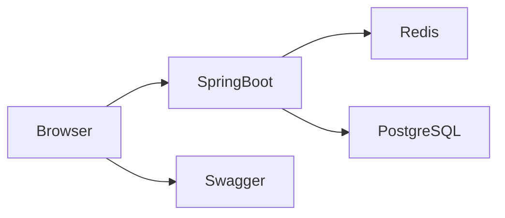

# LinkTrim

LinkTrim is a production-style modular monolith URL shortener built with Java 21, Spring Boot 3, PostgreSQL, Redis, Flyway, Docker Compose, and Springdoc OpenAPI.


## Frontend overview

The LinkTrim dashboard is served directly by Spring Boot at:

```text
http://localhost:8080/
```

The browser UI is implemented as plain HTML, CSS, and vanilla JavaScript inside the app's static resources. There is no separate frontend service or Node ecosystem; the same Spring Boot service serves the dashboard, API, and static assets from the same origin.

## Local URLs

- Frontend: http://localhost:8080/
- Swagger UI: http://localhost:8080/swagger-ui/index.html (developer/documentation endpoint)
- Health: http://localhost:8080/actuator/health

## Browser usage flow

1. Open the LinkTrim dashboard at http://localhost:8080/.
2. Paste a long URL and optionally set an expiration date.
3. Click Shorten to create a short link.
4. Copy, open, or inspect its analytics from the result area.
5. Use the analytics panel to view click counts and timestamps.
6. Delete the link from the danger section when needed.

## Architecture

The frontend is part of the same Spring Boot modular monolith as the backend. Browser requests are relative to the same origin, and the application serves static files plus API routes directly from the container at port 8080.



## Plain HTML/CSS/JavaScript implementation

The LinkTrim frontend uses:

- HTML for structure and semantics
- CSS variables and reusable layout patterns for the premium orange-and-blue LinkTrim dashboard
- vanilla JavaScript for API calls, form validation, analytics rendering, and notifications
- inline SVG for the custom LinkTrim mark and iconography

No separate frontend service, React, Vue, Node.js, or external CDN assets are used.

## Backend flow

```text
Browser → Spring Boot static UI/API → Redis → PostgreSQL
```

- PostgreSQL is the source of truth.
- Redis accelerates redirect lookups and cached metadata reads.
- Base62 creates compact, deterministic public URLs.
- The frontend belongs to the same Spring Boot monolith and is deployed with the backend, not as an independent app.

## Base62 explanation

LinkTrim generates a compact code by taking the numeric primary key used in PostgreSQL and encoding it using the Base62 alphabet:

`0123456789abcdefghijklmnopqrstuvwxyzABCDEFGHIJKLMNOPQRSTUVWXYZ`

This produces short, readable codes while avoiding random or UUID-based visible identifiers.

## Local setup commands

```bash
set JAVA_HOME=C:\Program Files\Java\jdk-21.0.12.1
set PATH=%JAVA_HOME%\bin;%PATH%

mvn clean verify
mvn spring-boot:run
```

## Docker startup commands

```bash
docker compose up --build -d
docker compose ps
```

## Vercel + Render + Neon deployment

This repository includes `vercel.json` for the static dashboard and `render.yaml` for the Render API and its Redis-compatible cache. Browser API requests and short-code redirects are proxied through Vercel, so the frontend and API are same-origin and do not need CORS configuration. Neon provides the durable PostgreSQL database; Flyway applies migrations when the API starts.

1. Create a Neon PostgreSQL project in a region close to the Render service. Use Neon's pooled connection host when available and require TLS in the JDBC URL, for example `jdbc:postgresql://<neon-host>/<database>?sslmode=require`.
2. Import this repository into Vercel with the repository root as the project root. `vercel.json` selects the existing static files directory; no frontend build step is needed. Deploy once to obtain the Vercel production URL.
3. In Render, create a Blueprint from this repository and use `render.yaml`. Enter `APP_BASE_URL` as the Vercel production URL (or your Vercel custom domain), along with Neon `SPRING_DATASOURCE_URL`, `SPRING_DATASOURCE_USERNAME`, and `SPRING_DATASOURCE_PASSWORD` when prompted. Keep the Render web service and Key Value in the same region.
4. After Render creates the web service, copy its public origin, such as `https://linktrim-api.onrender.com`. In Vercel project settings, set `BACKEND_URL` to that origin without a trailing slash for Production and Preview, then redeploy Vercel.
5. Verify the Vercel dashboard, `/actuator/health`, link creation, redirect, analytics, and deletion. Keep Render's `APP_BASE_URL` aligned with the public Vercel domain so created short URLs use the frontend origin.

The current application requires Redis for both URL caching and rate limiting, so `render.yaml` provisions Render Key Value as a supporting service. The free Key Value plan is small (currently 25 MB) and non-persistent; it is used only for transient cache and rate-limit state. Render's free web service can sleep while idle, so expect cold starts. Free-tier quotas and availability are controlled by the providers and may change.

## Docker Compose deployment alternative

The production Compose file runs only the application and connects it to managed PostgreSQL and Redis services. It requires explicit connection details and a public HTTPS origin; it does not publish database ports or use the local development credentials. The image runs as a non-root user.

For a Compose host, copy `.env.production.example` to the ignored `.env.production` file and replace every example value with your provider's real settings. Never commit `.env.production`. For other hosting platforms, configure the same values as secrets/environment variables:

- `APP_BASE_URL`: public HTTPS origin, for example `https://links.example.com` (no trailing slash)
- `SPRING_DATASOURCE_URL`, `SPRING_DATASOURCE_USERNAME`, `SPRING_DATASOURCE_PASSWORD`: managed PostgreSQL connection details; include provider-required TLS options in the JDBC URL
- `SPRING_DATA_REDIS_HOST`, `SPRING_DATA_REDIS_PORT`: managed Redis connection details
- `SPRING_DATA_REDIS_PASSWORD`: set when required by the Redis provider
- `SPRING_DATA_REDIS_SSL_ENABLED`: set to `true` when the Redis provider requires TLS
- `PORT`: optional application/listener port, defaults to `8080`
- `APP_IMAGE`: optional image tag when publishing to a registry

Build and start the production service after setting those values:

```bash
docker compose --env-file .env.production -f docker-compose.production.yml up --build -d
docker compose --env-file .env.production -f docker-compose.production.yml ps
```

For a platform that builds images separately, build and publish the `Dockerfile`, then set `APP_IMAGE` to the published tag and provide the same runtime environment variables. The app listens on `PORT`; configure the platform's public HTTP router to forward to that container port. No separate frontend service is needed.

After deployment, create a short URL and confirm the returned `shortUrl` starts with the deployed HTTPS origin. Also verify the root page, `/actuator/health`, the redirect, analytics, and deletion using that same public domain. Do not treat a successful local Docker run as deployment verification.

## API endpoints

- POST /api/v1/urls
- GET /{shortCode}
- GET /api/v1/urls/{shortCode}/stats
- DELETE /api/v1/urls/{shortCode}
- GET /actuator/health
- GET /v3/api-docs
- GET /swagger-ui/index.html

## Design notes

This application stays intentionally simple and readable. The monolith keeps operations predictable, while Redis handles short-lived redirect caching and PostgreSQL remains the canonical datastore for URL metadata and analytics.
