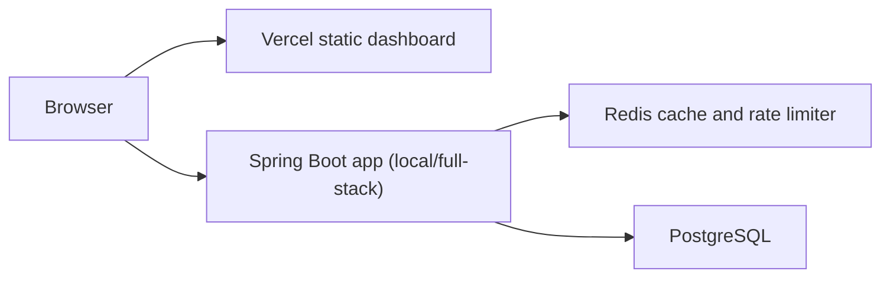

# LinkTrim

LinkTrim is a URL shortener built as a Java 21 and Spring Boot modular monolith, with a PostgreSQL database, Redis caching and rate limiting, and a lightweight HTML/CSS/JavaScript dashboard.

**Live dashboard:** [distributed-url-shortener-static.vercel.app](https://distributed-url-shortener-static.vercel.app/)

> **Deployment note:** The Vercel deployment serves the static frontend only. The Spring Boot API, PostgreSQL, and Redis are not deployed there, so creating links, redirects, analytics, and deletion require a running backend. Use the local full-stack setup below to try those features.


## Features

- Create short links with an optional expiration time.
- Redirect short codes to their original URLs and track clicks.
- Retrieve link statistics and delete links.
- Generate deterministic, compact Base62 codes from database IDs.
- Cache redirect lookups and apply per-IP rate limiting with Redis.
- Persist URL metadata in PostgreSQL and manage schema changes with Flyway.
- Serve the dashboard and API from the same Spring Boot application locally.

## Technology stack

- Java 21, Spring Boot 3, Maven
- Spring Web, Spring Data JPA, Jakarta Bean Validation
- PostgreSQL and Flyway
- Redis
- HTML, CSS, and vanilla JavaScript
- Docker Compose, Vercel (static frontend hosting)
- JUnit 5, Mockito, Spring Boot Test, and Testcontainers

## Architecture

The backend is a modular monolith. PostgreSQL is the source of truth; Redis caches redirect data and stores rate-limit counters. Flyway applies database migrations at startup.



The Vercel site does not proxy requests to the backend. In the local full-stack setup, Spring Boot serves the same static dashboard alongside the API.

## Run locally with Docker Compose

**Prerequisites:** Docker with the Compose plugin, and ports `8080`, `5432`, and `6379` available.

```bash
git clone https://github.com/NishGoyal01/Distributed-URL-Shortener.git
cd Distributed-URL-Shortener
docker compose up --build -d
```

Compose starts the Spring Boot app, PostgreSQL, and Redis. No `.env` file is required for the local defaults. Wait for the app to become healthy, then open:

- Dashboard: <http://localhost:8080/>
- Health: <http://localhost:8080/actuator/health>
- Swagger UI: <http://localhost:8080/swagger-ui/index.html>
- OpenAPI JSON: <http://localhost:8080/v3/api-docs>

To inspect startup output or stop the services:

```bash
docker compose logs -f app
docker compose down
```

## Run tests

The integration tests use Testcontainers to start PostgreSQL and Redis, so Docker must be running.

```bash
mvn test
```

## API

| Method | Path | Description |
| --- | --- | --- |
| `POST` | `/api/v1/urls` | Create a short URL |
| `GET` | `/{shortCode}` | Redirect to the original URL |
| `GET` | `/api/v1/urls/{shortCode}/stats` | Get click and URL statistics |
| `DELETE` | `/api/v1/urls/{shortCode}` | Delete a short URL |
| `GET` | `/actuator/health` | Check application health |

Create a link:

```bash
curl -X POST http://localhost:8080/api/v1/urls \
  -H "Content-Type: application/json" \
  -d '{"originalUrl":"https://example.com/articles/a-long-path","expiresAt":"2026-12-31T23:59:59Z"}'
```

`expiresAt` is optional and should be an ISO-8601 timestamp. A successful request returns the short code, short URL, original URL, and creation/expiration timestamps. The redirect endpoint responds with HTTP `302`; expired links return HTTP `410`.

## Configuration

The Docker Compose setup has local defaults. To override them, create a `.env` file from `.env.example`. For deployments, configure the corresponding environment variables with the target database and Redis connection details:

| Variable | Purpose |
| --- | --- |
| `APP_BASE_URL` | Public origin used when constructing short URLs |
| `SPRING_DATASOURCE_URL` | PostgreSQL JDBC URL |
| `SPRING_DATASOURCE_USERNAME` / `SPRING_DATASOURCE_PASSWORD` | PostgreSQL credentials |
| `SPRING_DATA_REDIS_HOST` / `SPRING_DATA_REDIS_PORT` | Redis connection |
| `SPRING_DATA_REDIS_PASSWORD` | Redis password, when required |
| `APP_CACHE_TTL_SECONDS` | Default redirect-cache lifetime |
| `APP_RATE_LIMIT_MAX_REQUESTS` / `APP_RATE_LIMIT_WINDOW_SECONDS` | Per-IP request limit and window |

Do not commit deployment credentials. The production Compose template is in `docker-compose.production.yml`; `.env.production.example` lists its required settings.

## Project structure

```text
src/
  main/
    java/com/example/urlshortener/  # Controllers, services, repositories, DTOs
    resources/
      db/migration/                 # Flyway SQL migrations
      static/                       # Dashboard HTML, CSS, and JavaScript
  test/                             # Unit and integration tests
docs/
  system-design.md                  # Design notes and request flows
```

For further design details, see [docs/system-design.md](docs/system-design.md).
