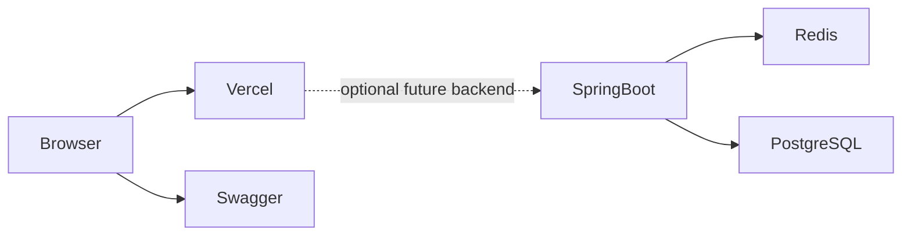

# LinkTrim

LinkTrim is a URL shortener with a Java 21 and Spring Boot backend, PostgreSQL, Redis, and a plain HTML/CSS/JavaScript frontend. The current deployment is a static frontend preview; the backend, Redis, and database are not deployed.


## Frontend overview

Vercel serves the LinkTrim dashboard as a static site:

```text
https://<your-vercel-domain>/
```

For local full-stack development, Spring Boot also serves these files at `http://localhost:8080/`. The UI uses plain HTML, CSS, and vanilla JavaScript; no frontend build or Node ecosystem is required.

## Local backend URLs

- Frontend: http://localhost:8080/
- Swagger UI: http://localhost:8080/swagger-ui/index.html (developer/documentation endpoint)
- Health: http://localhost:8080/actuator/health

## Local full-stack usage

Run the backend with PostgreSQL and Redis, then open http://localhost:8080/. The static Vercel preview does not connect to an API; link-management controls are enabled only when a healthy backend is available.

## Architecture

The backend is a modular monolith. In the current deployment, Vercel serves the frontend as static files; the Spring Boot service and its datastore dependencies are not deployed.



## Plain HTML/CSS/JavaScript implementation

The LinkTrim frontend uses:

- HTML for structure and semantics
- CSS variables and reusable layout patterns for the premium orange-and-blue LinkTrim dashboard
- vanilla JavaScript for API calls, form validation, analytics rendering, and notifications
- inline SVG for the custom LinkTrim mark and iconography

No separate frontend service, React, Vue, Node.js, or external CDN assets are used.

## Backend flow

```text
Browser → Spring Boot static UI/API → Redis → PostgreSQL
```

- PostgreSQL is the source of truth.
- Redis accelerates redirect lookups and cached metadata reads.
- Base62 creates compact, deterministic public URLs.
- The backend remains in this repository for a future deployment. Vercel's current configuration serves only the static frontend and does not proxy requests to it.

## Base62 explanation

LinkTrim generates a compact code by taking the numeric primary key used in PostgreSQL and encoding it using the Base62 alphabet:

`0123456789ABCDEFGHIJKLMNOPQRSTUVWXYZabcdefghijklmnopqrstuvwxyz`

This produces short, readable codes while avoiding random or UUID-based visible identifiers.

## Local setup commands

```bash
set JAVA_HOME=C:\Program Files\Java\jdk-21.0.12.1
set PATH=%JAVA_HOME%\bin;%PATH%

mvn clean verify
mvn spring-boot:run
```

## Docker startup commands

```bash
docker compose up --build -d
docker compose ps
```

## Current deployment: static frontend on Vercel

Vercel serves only the static dashboard from `src/main/resources/static`. No backend, Redis, or database is built or deployed, and there are no API proxy routes. The dashboard detects that the API is unavailable and disables link-management controls.

Import the repository into Vercel with the repository root as the project root. `vercel.json` selects the existing static files directory; no frontend build step or backend environment variables are required.

## Optional backend deployment (later)

The backend deployment configuration is retained for later use. To deploy it, provision PostgreSQL and Redis, then use the Render Blueprint in `render.yaml` or the production Docker setup below. These steps are not part of the current Vercel deployment.

1. Create a PostgreSQL project and configure a TLS-enabled JDBC URL.
2. In Render, create a Blueprint from this repository and use `render.yaml`. Configure the Vercel URL and PostgreSQL credentials when prompted.
3. Configure the Vercel project with the backend origin and add API proxy routes before enabling backend features.

The application requires Redis for URL caching and rate limiting. `render.yaml` provisions a Redis-compatible cache with the API service.

## Optional Docker backend deployment (later)

The production Compose file runs the application and connects it to managed PostgreSQL and Redis services. For a Compose host, copy `.env.production.example` to the ignored `.env.production` file and replace every example value with your provider's real settings. Never commit `.env.production`.

- `APP_BASE_URL`: public HTTPS origin, for example `https://links.example.com` (no trailing slash)
- `SPRING_DATASOURCE_URL`, `SPRING_DATASOURCE_USERNAME`, `SPRING_DATASOURCE_PASSWORD`: managed PostgreSQL connection details; include provider-required TLS options in the JDBC URL
- `SPRING_DATA_REDIS_HOST`, `SPRING_DATA_REDIS_PORT`: managed Redis connection details
- `SPRING_DATA_REDIS_PASSWORD`: set when required by the Redis provider
- `SPRING_DATA_REDIS_SSL_ENABLED`: set to `true` when the Redis provider requires TLS
- `PORT`: optional application/listener port, defaults to `8080`
- `APP_IMAGE`: optional image tag when publishing to a registry

Build and start the production service after setting those values:

```bash
docker compose --env-file .env.production -f docker-compose.production.yml up --build -d
docker compose --env-file .env.production -f docker-compose.production.yml ps
```

For a platform that builds images separately, build and publish the `Dockerfile`, then set `APP_IMAGE` to the published tag and provide the same runtime environment variables. The app listens on `PORT`; configure the platform's public HTTP router to forward to that container port. No separate frontend service is needed.

After a future backend deployment, verify the root page, `/actuator/health`, link creation, redirects, analytics, and deletion. Do not treat a successful local Docker run as deployment verification.

## API endpoints

- POST /api/v1/urls
- GET /{shortCode}
- GET /api/v1/urls/{shortCode}/stats
- DELETE /api/v1/urls/{shortCode}
- GET /actuator/health
- GET /v3/api-docs
- GET /swagger-ui/index.html

## Design notes

This application stays intentionally simple and readable. The monolith keeps operations predictable, while Redis handles short-lived redirect caching and PostgreSQL remains the canonical datastore for URL metadata and analytics.
